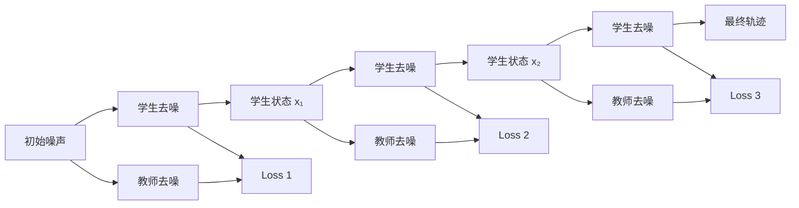

DDIM 蒸馏目标定义为 **基于学生去噪路径的逐步转移匹配（On-Policy Transition Matching）**。

这与 DiffusionOPD 和 VLA-MOPD 的核心思想一致。下面从 DDIM 的采样公式开始推导，最终得到可以直接用于训练的 MOPD 损失函数。

# 1. DDIM 的基本数学定义

## 1.1 前向加噪

DDIM 与 DDPM 使用相同的前向加噪公式。

$x_t=\sqrt{\bar\alpha_t}x_0+\sqrt{1-\bar\alpha_t}\epsilon, \qquad \epsilon\sim\mathcal N(0,I) \tag{1}$

其中：

- $x_0\in\mathbb R^{H\times D}$ 为归一化后的真实驾驶轨迹。
- $x_t$ 为扩散时刻 $t$ 的带噪轨迹。
- $H$ 为轨迹路点数量。
- $D$ 为每个路点的维度，ReCogDrive 中为横纵坐标和航向角。
- $\bar\alpha_t$ 为噪声调度器确定的累计信号保留系数。
- $\epsilon$ 为标准高斯噪声。

ReCogDrive 在模仿学习阶段使用标准的噪声预测损失。

$\mathcal L_{\mathrm{IL}} = \mathbb E_{x_0,c,t,\epsilon} \left[ \left\|\epsilon-\epsilon_\theta(x_t,t,c)\right\|_F^2 \right] \tag{2}$

$c$ 表示驾驶场景条件，包括 VLM 特征、自车历史轨迹和自车状态等信息。

$\epsilon_\theta$ 是动作头预测的噪声。

---

## 1.2 DDIM 单步去噪

根据 DDIM 原文式（12），扩散模型首先根据预测噪声估计干净轨迹。

$\hat x_0^\theta = \frac{x_t-\sqrt{1-\bar\alpha_t}\epsilon_\theta(x_t,t,c)} {\sqrt{\bar\alpha_t}} \tag{3}$

随后，DDIM 将轨迹从扩散时刻 $t$ 更新到噪声更少的时刻 $s$，其中 $s<t$。

$x_s = \underbrace{\sqrt{\bar\alpha_s}\hat x_0^\theta}_{\text{预测轨迹分量}} + \underbrace{\sqrt{1-\bar\alpha_s-\sigma_{t,s}^2} \epsilon_\theta(x_t,t,c)}_{\text{保留噪声分量}} + \underbrace{\sigma_{t,s}z}_{\text{随机噪声分量}} \tag{4}$

其中 $z\sim\mathcal N(0,I)$，噪声标准差为：

$\sigma_{t,s} = \eta \sqrt{ \frac{1-\bar\alpha_s}{1-\bar\alpha_t} \left(1-\frac{\bar\alpha_t}{\bar\alpha_s}\right) } \tag{5}$

$\eta$ 控制去噪过程中的随机性。

- $\eta=0$ 时，每一步去噪都是确定性的。
- $\eta>0$ 时，每一步可以额外引入随机噪声。

来源：[DDIM 原文 §4.1–4.3](https://arxiv.org/html/2010.02502)

我们将式（4）中的前两项定义为单步转移均值。

$\mu_\theta(x_t,t,s,c) = \sqrt{\bar\alpha_s}\hat x_0^\theta + \sqrt{1-\bar\alpha_s-\sigma_{t,s}^2} \epsilon_\theta(x_t,t,c) \tag{6}$

因此，整个 DDIM 单步去噪过程可以简写为：

$x_s=\mu_\theta(x_t,t,s,c)+\sigma_{t,s}z \tag{7}$

后续蒸馏的核心对象就是这个 $\mu_\theta$。

# 2. 从 KL 散度推导 DDIM 蒸馏损失

## 2.1 学生和教师的单步转移分布

设学生参数为 $\theta$，第 $i$ 个领域教师的参数为 $\phi_i$。

学生和教师读取完全相同的带噪轨迹 $x_t$、扩散时刻 $t$ 和场景条件 $c$，分别预测下一步去噪结果。

当 $\sigma_{t,s}>0$ 且采样噪声服从未裁剪的高斯分布时：

$p_\theta(x_s\mid x_t,c) = \mathcal N(\mu_\theta,\sigma_{t,s}^2I) \tag{8}$$p_{\phi_i}(x_s\mid x_t,c) = \mathcal N(\mu_{\phi_i},\sigma_{t,s}^2I) \tag{9}$

学生和教师采用相同的 DDIM 调度器，因此二者具有相同的协方差，差别来自各自动作头预测的转移均值。

我们希望最小化 Reverse KL：

$\mathcal L_{\mathrm{RKL}} = D_{\mathrm{KL}} \left( p_\theta\;\|\;p_{\phi_i} \right) \tag{10}$

## 2.2 KL 散度的具体展开

对于两个协方差相同的高斯分布，其概率密度之比满足：

$\log\frac{p_\theta(x_s)}{p_{\phi_i}(x_s)} = \frac{ \|x_s-\mu_{\phi_i}\|_F^2 - \|x_s-\mu_\theta\|_F^2 }{2\sigma_{t,s}^2} \tag{11}$

根据 KL 散度的定义：

$\mathcal L_{\mathrm{RKL}} = \mathbb E_{x_s\sim p_\theta} \left[ \log\frac{p_\theta(x_s)}{p_{\phi_i}(x_s)} \right] \tag{12}$

由于 $x_s$ 来自学生的高斯分布，可以将其写为：

$x_s=\mu_\theta+\sigma_{t,s}z, \qquad z\sim\mathcal N(0,I)$

代入式（11）：

$\begin{aligned} \mathcal L_{\mathrm{RKL}} &= \frac{1}{2\sigma_{t,s}^2} \mathbb E_z \left[ \|\mu_\theta-\mu_{\phi_i}+\sigma_{t,s}z\|_F^2 - \|\sigma_{t,s}z\|_F^2 \right]\\ &= \frac{1}{2\sigma_{t,s}^2} \mathbb E_z \left[ \|\mu_\theta-\mu_{\phi_i}\|_F^2 + 2\sigma_{t,s} \langle\mu_\theta-\mu_{\phi_i},z\rangle \right]. \end{aligned}$

由于 $\mathbb E[z]=0$，第二项的期望为零。

最终得到：

$\boxed{ D_{\mathrm{KL}} \left(p_\theta\|p_{\phi_i}\right) = \frac{1}{2\sigma_{t,s}^2} \left\|\mu_\theta-\mu_{\phi_i}\right\|_F^2 } \tag{13}$

**这个公式说明，对于共享固定方差的高斯转移分布，KL 散度能够精确地转换为带权重的均值平方误差。**

因此，我们只需要教师进行一次前向计算，就能够计算完整的单步 KL 散度，无需让教师多次采样。

这也是 DiffusionOPD 原文式（10）和式（11）的理论基础。[DiffusionOPD §3.2](https://arxiv.org/html/2605.15055v1)

# 3. 将转移均值蒸馏转换为噪声蒸馏

我们进一步将式（3）代入式（6）。

$\begin{aligned} \mu_\theta ={}& \sqrt{\frac{\bar\alpha_s}{\bar\alpha_t}}x_t\\ &+ \left( \sqrt{1-\bar\alpha_s-\sigma_{t,s}^2} - \sqrt{\frac{\bar\alpha_s(1-\bar\alpha_t)}{\bar\alpha_t}} \right) \epsilon_\theta(x_t,t,c) \end{aligned} \tag{14}$

为了简化公式，定义两个由 DDIM 调度器确定的系数。

$a_{t,s} = \sqrt{\frac{\bar\alpha_s}{\bar\alpha_t}}$$b_{t,s} = \sqrt{1-\bar\alpha_s-\sigma_{t,s}^2} - \sqrt{\frac{\bar\alpha_s(1-\bar\alpha_t)}{\bar\alpha_t}}$

则学生和教师的转移均值分别为：

$\mu_\theta=a_{t,s}x_t+b_{t,s}\epsilon_\theta$$\mu_{\phi_i}=a_{t,s}x_t+b_{t,s}\epsilon_{\phi_i}$

因为学生和教师使用相同的输入 $x_t$，第一项相消。

$\mu_\theta-\mu_{\phi_i} = b_{t,s} \left(\epsilon_\theta-\epsilon_{\phi_i}\right) \tag{15}$

将式（15）代入式（13），得到：

$\boxed{ \mathcal L_{\mathrm{RKL}} = \frac{b_{t,s}^2}{2\sigma_{t,s}^2} \left\| \epsilon_\theta(x_t,t,c) - \epsilon_{\phi_i}(x_t,t,c) \right\|_F^2 } \tag{16}$

这就是随机 DDIM 下，从 KL 散度推导出的噪声蒸馏损失。

这里的 $b_{t,s}^2/\sigma_{t,s}^2$ 是由采样器推导出来的时间步权重。不同去噪阶段的噪声预测误差，对实际去噪结果的影响程度不同。

上述噪声形式的等价关系假设采样过程中没有额外的轨迹和噪声裁剪。

# 4. 确定性 DDIM 的蒸馏损失

我们的第一阶段实验更适合使用 $\eta=0$ 的确定性 DDIM。

此时：

$x_s=\mu_\theta(x_t,t,s,c) \tag{17}$

给定当前带噪轨迹，学生和教师分别输出唯一的下一步轨迹。

从概率论上看，这两个条件分布是 Dirac 分布，即全部概率集中在一个点上。

$p_\theta=\delta_{\mu_\theta}, \qquad p_{\phi_i}=\delta_{\mu_{\phi_i}}$

其 KL 散度为：

$D_{\mathrm{KL}} \left(\delta_{\mu_\theta}\|\delta_{\mu_{\phi_i}}\right) = \begin{cases} 0,&\mu_\theta=\mu_{\phi_i}\\ +\infty,&\mu_\theta\neq\mu_{\phi_i} \end{cases}$

因此，确定性 DDIM 应当采用逐步转移平方误差作为优化目标。这也是 VLA-MOPD 和 DiffusionOPD 对确定性采样器使用的处理方式。

$\boxed{ \mathcal L_{\mathrm{step}}^{(i)} = \frac12 \left\| \mu_\theta(x_t,t,s,c) - \mu_{\phi_i}(x_t,t,s,c) \right\|_F^2 } \tag{18}$

在无裁剪的情况下，代入式（15）可以得到等价的噪声蒸馏形式：

$\boxed{ \mathcal L_{\mathrm{step}}^{(i)} = \frac{b_{t,s}^2}{2} \left\| \epsilon_\theta(x_t,t,c) - \epsilon_{\phi_i}(x_t,t,c) \right\|_F^2 } \tag{19}$

其中：

$b_{t,s} = \sqrt{1-\bar\alpha_s} - \sqrt{\frac{\bar\alpha_s(1-\bar\alpha_t)}{\bar\alpha_t}}$

**式（18）是我更推荐用于 ReCogDrive 的蒸馏目标。** 它直接监督每一步 DDIM 的实际去噪结果。

来源：[DiffusionOPD 原文式（12）](https://arxiv.org/html/2605.15055v1)、[VLA-MOPD 原文式（5）及附录 B](https://arxiv.org/html/2611.12286v1)。

# 5. 从单步蒸馏扩展到 On-Policy Distillation

设 DDIM 一共执行 $K$ 步去噪，扩散时间序列为：

$t_0>t_1>\cdots>t_K=0$

学生从随机噪声开始，完整生成去噪路径：

$\mathcal C_\theta = \left\{ x_{t_0}^{S}, x_{t_1}^{S}, \ldots, x_{t_K}^{S} \right\}$

每一步均由学生自己生成。

$x_{t_{k+1}}^S = \mu_\theta \left(x_{t_k}^{S},t_k,t_{k+1},c\right) \tag{20}$

整个蒸馏过程如下。

````

````

例如，学生经过第一步去噪得到 $x_{t_1}^{S}$，此时教师读取这个学生生成的状态，预测应该如何继续去噪。学生学习教师在这个状态下给出的修正方向。

因此，即使学生前几步去噪出现偏差，后续仍然可以获得教师的监督。

## 5.1 为什么逐步匹配能够改善最终轨迹？

设学生和教师的确定性单步转移函数分别为 $f_k^S$ 和 $f_k^T$。

定义学生在第 $k$ 步的蒸馏误差：

$e_k= \left\|f_k^S(x_k^S)-f_k^T(x_k^S)\right\|_F$

定义相同初始噪声下，学生和教师各自生成的中间状态偏差：

$\Delta_k=\|x_k^S-x_k^T\|_F$

假设教师的第 $k$ 步转移函数满足 Lipschitz 连续性，常数为 $L_k$，根据三角不等式：

$\begin{aligned} \Delta_{k+1} &= \left\|f_k^S(x_k^S)-f_k^T(x_k^T)\right\|_F\\ &\leq \left\|f_k^S(x_k^S)-f_k^T(x_k^S)\right\|_F\\ &\quad+ \left\|f_k^T(x_k^S)-f_k^T(x_k^T)\right\|_F\\ &\leq e_k+L_k\Delta_k. \end{aligned} \tag{21}$

由于学生和教师从相同初始噪声开始，$\Delta_0=0$，递推可得：

$\boxed{ \Delta_K \leq \sum_{k=0}^{K-1} e_k \prod_{j=k+1}^{K-1}L_j } \tag{22}$

这个公式给出了逐步蒸馏的一个理论依据：减小每一步去噪误差，就能够减小最终轨迹偏差的上界。

同时，公式也说明早期去噪误差可能经过后续步骤传播。因此，各个去噪阶段的蒸馏重要程度值得进一步研究。

这里保证的是学生与教师生成轨迹之间的误差上界。最终 PDMS 是否提升，仍然取决于教师的规划能力。

# 6. ReCogDrive 的 MOPD 最终损失

假设我们训练了 $M$ 个领域教师，例如：

- $\phi_1$：转弯教师。
- $\phi_2$：刹车教师。
- $\phi_3$：汇车教师。
- $\phi_4$：常规驾驶教师。

令 $\mathcal D_i$ 为第 $i$ 个领域对应的驾驶场景集合，$w_i$ 为该领域的采样权重。

$\sum_{i=1}^{M}w_i=1,\qquad w_i\geq0$

令 $\bar\theta$ 表示本轮生成去噪路径时的学生参数，生成的路径记为 $\mathcal C_{\bar\theta}$。

我们的最终优化目标可以写为：

$\boxed{ \begin{aligned} \mathcal L_{\mathrm{MOPD}}(\theta;\bar\theta) ={}& \sum_{i=1}^{M}w_i \mathbb E_{\substack{ c\sim\mathcal D_i\\ \mathcal C_{\bar\theta}\sim Q_{\bar\theta}(\cdot\mid c) }} \left[ \frac{1}{2KHD} \sum_{k=0}^{K-1} \left\| \mu_{\theta,k}(x_{t_k}^{S},c) - \operatorname{sg}\left[ \mu_{\phi_i,k}(x_{t_k}^{S},c) \right] \right\|_F^2 \right]. \end{aligned} } \tag{23}$

各个符号的含义如下。

|符号|含义|
|---|---|
|$M$|领域教师数量|
|$i$|当前驾驶场景对应的教师编号|
|$w_i$|对应领域的训练权重|
|$K$|DDIM 去噪步数|
|$H$|规划轨迹路点数量|
|$D$|单个路点的维度|
|$x_{t_k}^{S}$|学生在第 $k$ 步去噪时生成的带噪轨迹|
|$\mu_{\theta,k}$|学生预测的下一步去噪结果|
|$\mu_{\phi_i,k}$|当前领域教师预测的下一步去噪结果|
|$\operatorname{sg}$|停止梯度传播|
|$Q_{\bar\theta}$|本轮学生去噪路径的采样分布|

**式（23）可以直接作为我们第一阶段 MOPD 实验的主损失。**

# 7. 梯度传播的理论问题

这一部分需要在论文中严谨地说明。

假设我们已经保存了学生生成的去噪路径。训练时，将每个中间状态和教师输出视为固定数据，仅对学生重新执行的前向计算进行反向传播。

因此，式（23）的单步梯度为：

$\begin{aligned} \nabla_\theta\mathcal L_{\mathrm{step}}^{(i)} = J_{\theta,k}^{\top} \left( \mu_{\theta,k} - \mu_{\phi_i,k} \right) \end{aligned} \tag{24}$

其中：

$J_{\theta,k} = \frac{\partial\mu_{\theta,k}(x_{t_k}^{S},c)} {\partial\theta}$

$J_{\theta,k}$ 表示学生动作头参数的变化会如何影响本次去噪结果。

这里采用了 **固定采样路径、更新学生、重新采样** 的迭代优化方式。

需要区分两种数学目标。对于随机采样器，如果直接定义：

$\mathcal J(\theta) = \mathbb E_{\mathcal C\sim Q_\theta} \left[ \sum_k\ell_\theta(x_{t_k}) \right]$

其完整梯度包含两项：

$\begin{aligned} \nabla_\theta\mathcal J ={}& \mathbb E_{Q_\theta} \left[\sum_k\nabla_\theta\ell_\theta(x_{t_k})\right]\\ &+ \mathbb E_{Q_\theta} \left[ \left(\sum_k\ell_\theta(x_{t_k})\right) \nabla_\theta\log Q_\theta(\mathcal C) \right]. \end{aligned} \tag{25}$

第一项是固定中间状态时的蒸馏梯度，第二项来自采样路径本身对学生参数的依赖。

我们的式（23）通过固定 $\bar\theta$ 来定义每一轮的优化目标，式（24）是该目标的精确梯度。每次更新学生后重新采样，使训练数据持续跟随学生当前的去噪分布。

VLA-MOPD 原文式（6）和式（7）也明确采用了这种优化方式，称为 Frozen-Snapshot Projection。[VLA-MOPD §4.2](https://arxiv.org/html/2611.12286v1)

# 8. ReCogDrive 实际代码中的细节

我检查了 ReCogDrive 的 `p_mean_variance()` 和 `sample_chain()`，发现其 DDIM 实现还有一个轨迹裁剪操作。

网络首先预测干净轨迹，然后执行：

$\tilde x_0^\theta = \operatorname{clip} \left( \frac{x_t-\sqrt{1-\bar\alpha_t}\epsilon_\theta} {\sqrt{\bar\alpha_t}}, -1,1 \right) \tag{26}$

随后，根据裁剪后的干净轨迹重新计算噪声。

$\tilde\epsilon_\theta = \frac{x_t-\sqrt{\bar\alpha_t}\tilde x_0^\theta} {\sqrt{1-\bar\alpha_t}} \tag{27}$

最终计算 DDIM 转移均值。

$\mu_\theta = \sqrt{\bar\alpha_s}\tilde x_0^\theta + \sqrt{1-\bar\alpha_s-\sigma_{t,s}^2} \tilde\epsilon_\theta \tag{28}$

所以，在 ReCogDrive 中直接匹配 `p_mean_variance()` 输出的 `mean`，可以保留原有采样器的实际计算逻辑。

原始预测噪声的 MSE 与实际转移均值的 MSE 在裁剪生效时会出现差异。

另外，ReCogDrive 的随机采样还存在标准差下限和随机噪声裁剪，这会影响前面高斯 KL 推导的成立条件。

**我建议第一阶段统一使用 `deterministic=True` 生成学生去噪路径，并用相同的设置计算教师目标。** 所有实验组采用相同的采样设置进行公平比较。

代码位置：[ReCogDrive DDIM 单步转移计算 (line 370)](C:/Users/user/Desktop/RISE/recogdrive-main/navsim/agents/recogdrive/recogdrive_diffusion_planner.py:370)。

## 8.1 训练伪代码

```
for context, domain_id in dataloader:

    teacher = teachers[domain_id]

    # 学生生成完整去噪路径
    with torch.no_grad():
        chain = student.sample_chain(
            context, deterministic=True
        )

    loss = 0

    for k in range(K):

        x_t = chain[k].detach()

        # 领域教师预测下一步去噪结果
        with torch.no_grad():
            teacher_mean = teacher.ddim_step_mean(
                x_t, timestep[k], context
            )

        # 学生在相同状态下重新预测
        student_mean = student.ddim_step_mean(
            x_t, timestep[k], context
        )

        loss += 0.5 * mse(student_mean, teacher_mean)

    loss = loss / K

    optimizer.zero_grad()
    loss.backward()
    optimizer.step()
```

实际实现时，可以将 $K$ 个已经保存的中间状态合并到 batch 维度中，并行计算教师和学生的蒸馏目标，减少逐步训练的开销。

# 9. 与已有工作的数学对照

## 9.1 VLA-MOPD 与我们的 DDIM-MOPD

VLA-MOPD 使用流匹配模型。其原文式（2）定义的 Euler 更新为：

$\mu_{\theta,k} = x_k-\delta_kv_\theta(x_k,s_k,c)$

其中 $v_\theta$ 是网络预测的流速度，$\delta_k$ 是积分步长。

因此，他们的确定性蒸馏损失为原文式（5）：

$\mathcal L_{\mathrm{VLA}} = \frac{\delta_k^2}{2} \|v_\theta-v_{\phi_i}\|_F^2$

我们的 DDIM 对应：

$\mathcal L_{\mathrm{DDIM}} = \frac{b_{t,s}^2}{2} \|\epsilon_\theta-\epsilon_{\phi_i}\|_F^2$

在不考虑裁剪的情况下，两者具有高度一致的数学结构。

||VLA-MOPD|我们的 DDIM-MOPD|
|---|---|---|
|生成模型|流匹配|DDIM|
|网络输出|速度 $v_\theta$|噪声 $\epsilon_\theta$|
|转移系数|$\delta_k$|$b_{t,s}$|
|蒸馏对象|单步 ODE 转移|单步 DDIM 转移|
|监督状态|学生生成的中间状态|学生生成的中间状态|

来源：[VLA-MOPD §4.2](https://arxiv.org/html/2611.12286v1)。

## 9.2 其他相关工作

|工作|蒸馏形式|对我们的参考价值|
|---|---|---|
|[MOPD](https://arxiv.org/html/2606.30406v1)|学生生成 token，领域教师提供条件概率分布，优化 Reverse KL|同源教师、领域特化和多教师训练框架|
|[DiffusionOPD](https://arxiv.org/html/2605.15055v1)|随机扩散采用高斯 KL，确定性采样采用转移匹配|最直接的数学依据|
|[VLA-MOPD](https://arxiv.org/html/2611.12286v1)|匹配学生和教师的流匹配单步转移结果|最接近我们的连续动作蒸馏场景|
|[MiMo-V2-Flash](https://arxiv.org/html/2601.02780v2)|结合在线蒸馏和最终任务奖励|后续可以结合 ReCogDrive 的 PDMS 强化学习|
|[Open-MOPD](https://arxiv.org/html/2608.19098v1)|研究多领域蒸馏中的能力失衡|后续调整领域损失权重|
|[D3-MOPD](https://arxiv.org/html/2608.24987v2)|根据学生学习进度动态调整领域采样比例|后续调整领域采样权重 $w_i$|

此外，VLA-MOPD 还会让机器人实际执行学生动作，从而获得学生访问的环境观测。我们在 NAVSIM 上的初期实验使用已有驾驶场景，在动作生成的内部去噪过程中执行 OPD。因此，我们的实验主要验证生成过程内部的分布偏移问题。

# 10. 从审稿人角度看我们的方案

目前的理论推导是成立的，但有几个需要通过实验验证的问题。

|问题|需要验证的内容|
|---|---|
|OPD 的必要性|学生路径蒸馏是否优于教师路径蒸馏|
|多教师的必要性|多个特化教师蒸馏是否优于单个全领域教师蒸馏|
|专家特化的有效性|每个领域教师是否真的在对应场景中优于普通模型|
|去噪监督的有效性|逐步蒸馏是否优于仅监督最终生成轨迹|
|多领域能力冲突|蒸馏后学生能否同时保留刹车、转弯、汇车等能力|

从创新性上看，DiffusionOPD 已经给出了通用扩散模型的逐步蒸馏理论，VLA-MOPD 也已经将这种方法应用于连续动作生成。

因此，我们目前这套 DDIM-MOPD 更适合作为一个**理论清楚、可复现的研究基线**。后续真正值得研究的，是智驾多领域之间的能力冲突、专家特化方式，以及不同去噪阶段的教师监督如何影响最终规划性能。

尤其是式（22），它给我们提供了一个可以继续研究的方向：不同去噪阶段的误差对最终轨迹具有不同影响，是否能够根据这种影响设计更合理的多教师蒸馏权重。